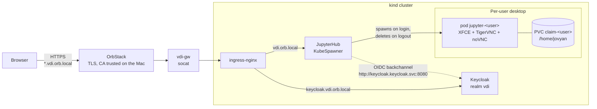

# k8svdi

Linux desktops in the browser on **kind + OrbStack**. Each user signs in with **Keycloak** and gets their own XFCE + noVNC pod, which is destroyed on logout or shutdown.

## Requirements

- macOS with [OrbStack](https://orbstack.dev) running.
- `kubectl`, `docker`. `kind` and `helm` are installed with Homebrew if missing.

## Usage

```bash
./scripts/up.sh       # brings everything up (idempotent): cluster, ingress, gateway, Keycloak, portal
./scripts/info.sh     # URLs and credentials
./scripts/e2e-test.sh # end-to-end test: login -> pod -> desktop -> logout/shutdown -> pod deleted
./scripts/audit.sh    # audit trail: login, logout, desktop_start, desktop_stop
./scripts/down.sh     # destroys the cluster (keeps .secrets/)
```

Open **https://vdi.orb.local** and sign in with a user from `./scripts/info.sh`.

## Architecture



| Component | Details |
|---|---|
| Gateway | OrbStack routes HTTPS to a container's exposed port, and kind nodes cannot carry labels, so the `vdi-gw` container owns the `*.vdi.orb.local` domain and forwards to the ingress. |
| Keycloak | Dev mode; the realm is re-imported on every start from `keycloak/realm-vdi.json.tpl` + `keycloak/users.txt`. OIDC client `jupyterhub` with a `groups` claim. |
| Backchannel | The Hub talks to Keycloak over `http://keycloak.keycloak.svc:8080` (pods do not trust the OrbStack CA); the issuer is still the public https URL. |
| Portal | `deploy/helm/k8svdi` chart (JupyterHub 4.4.3) with auto-login, `shutdown_on_logout`, and Keycloak or Entra ID. |
| Desktop | `images/desktop`: base-notebook + XFCE + TigerVNC + `jupyter-remote-desktop-proxy` + Epiphany (lightweight browser). |

## Helm chart and Argo CD

`deploy/helm/k8svdi` is an umbrella chart over the official JupyterHub chart (4.4.3). The lab uses it (`scripts/30-portal.sh`), and the same chart works for production.

| Value | Purpose |
|---|---|
| `host` | Public hostname of the portal |
| `auth.provider` | `keycloak` or `entra` |
| `auth.clientId`, `auth.clientSecret` | OIDC client. Without `clientSecret`, the chart expects a `k8svdi-oidc` Secret (key `client-secret`) created elsewhere (External Secrets, Sealed Secrets...) |
| `auth.allowedGroups`, `auth.adminGroups` | Keycloak groups or Entra ID App Roles |
| `auth.keycloak.realmUrl`, `internalRealmUrl` | Public realm URL and, optionally, an internal URL for the backchannel |
| `auth.entra.tenantId`, `groupsClaim` | Tenant and authorisation claim (`roles` recommended) |
| `profiles` | Desktop profiles per group or role |
| `audit.enabled` | Audit logging |
| `jupyterhub.*` | Passed as-is to the JupyterHub chart (ingress, TLS, image, storage, culler...) |

Values files in `deploy/values/`:

- `lab-keycloak.yaml`: this lab.
- `prod-entra.example.yaml`: Entra ID directly. App Registration with redirect URI `https://<host>/hub/oauth_callback` and App Roles `vdi-users` / `vdi-admins`.
- `prod-keycloak.example.yaml`: Keycloak. To have Keycloak delegate sign-in to Entra ID, merge `keycloak/entra-broker.example.json` into the realm; Entra App Roles are mapped to groups and the portal does not change.

```bash
helm dependency build deploy/helm/k8svdi
helm upgrade --install vdi deploy/helm/k8svdi -n vdi --create-namespace -f deploy/values/prod-entra.yaml
```

Argo CD: `deploy/argocd/k8svdi-entra.yaml` and `k8svdi-keycloak.yaml` (set `repoURL` and copy the matching `.example.yaml`). The k8svdi configuration is only read when the Hub starts; a post-upgrade hook (PostSync in Argo CD) restarts it on every update without affecting open desktops.

## Desktop lifecycle

The `jupyter-<user>` pod is deleted when:

- the user logs out of the portal (even if the desktop was still starting);
- they log out of XFCE (`vdi-xstartup`);
- they use the **Shut down desktop** launcher (`vdi-shutdown`, which calls the Hub API);
- it has been idle for 30 minutes (idle culler).

`/home/jovyan` persists on the `claim-<user>` PVC (2 Gi). To reset a user: `kubectl --context kind-vdi -n vdi delete pvc claim-<user>`.

## Profiles per group

| Keycloak group | Profiles |
|---|---|
| `vdi-users` | Standard (1 CPU / 2 GB), no selection form |
| `vdi-admins` | Standard or Power (2 CPU / 4 GB); also Hub admin (`/hub/admin`) |

They are defined under `profiles` in the chart values.

## Users and secrets

- Users live in `keycloak/users.txt` (`username firstName lastName groups`). After editing it: `./scripts/20-keycloak.sh`.
- Passwords are generated on first start into `.secrets/` (ignored by git) and reused. Delete a file to rotate that password.

## Hooks and auditing

`deploy/helm/k8svdi/files/k8svdi.py` defines `post_auth_hook`, `pre_spawn_hook`, `post_stop_hook` and a logout wrapper. Each event is written as JSON to the Hub log (`AUDIT ...`) and to `/srv/jupyterhub/audit.jsonl` (on the Hub's PVC).

## Capacity guide

An idle desktop uses about 235 MB; with a browser open, about 1 to 1.5 GB. A 64 GB node fits roughly 40 to 50 desktops under typical use. To reflect this in the scheduler, raise `singleuser.memory.guarantee` to about 1G.

## Known limitations

- ingress-nginx stopped being maintained in March 2026; candidate for replacement with Traefik or the Gateway API.
- Desktop `NetworkPolicy` is enabled (egress to private IPs is blocked, except to the Hub).
- Keycloak runs in dev mode without a persistent database: changes made by hand in the console are lost on restart.
- Keycloak logout shows a confirmation screen (no `id_token_hint` is sent).
- WebKit runs without its sandbox (`WEBKIT_DISABLE_SANDBOX_THIS_IS_DANGEROUS=1`); isolation comes from the pod itself.
